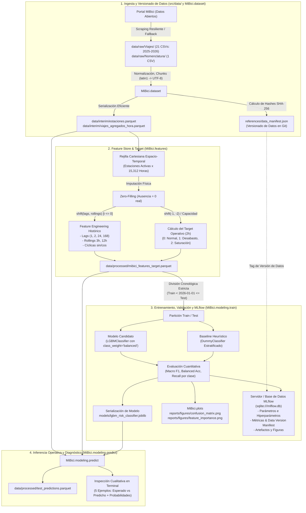

# Diagrama de Arquitectura del Sistema MLOps (MiBici)

Este documento detalla la arquitectura modular end-to-end implementada para responder a la **Pregunta 2 de MiBici**: Predicción anticipada (2 horas) de riesgo de desabasto y saturación en estaciones.

---

## 1. Diagrama de Arquitectura End-to-End

---

## 2. Descripción de Componentes y Módulos

### Módulo 1: Ingesta y Versionado (`MiBici.dataset`)
* **Propósito:** Automatizar la descarga desatendida, normalizar nombres de variables, codificación y tipos temporales, consolidando los datos en formato Parquet (`data/interim/`).
* **Mecanismo de Versionado:** Genera un manifiesto criptográfico en `references/data_manifest.json` que registra el hash SHA-256 de cada archivo individual y calcula un hash global para la versión del dataset (ej. `mibici-v2025_2026-d6201b6995`), consumible directamente por MLflow.

### Módulo 2: Ingeniería de Características (`MiBici.features`)
* **Propósito:** Generar la matriz cartesiana continua y construir variables explicativas utilizando **exclusivamente datos del pasado ($t \le 0$)**.
* **Zero-Filling:** Convierte horas inactivas en ceros físicos reales para mantener la continuidad matemática de las series temporales.
* **Target Sin Leakage:** Formula el balance futuro de las 2 horas subsecuentes ($\Delta_{\text{net}} = \text{Llegadas}_{[t+1, t+2]} - \text{Salidas}_{[t+1, t+2]}$), discretizado en 3 clases según el ratio sobre la capacidad de la estación ($\le -0.50$, $\ge 0.50$ o intermedio).
* **Almacenamiento:** Serializa el dataset limpio en `data/processed/mibici_features_target.parquet`.

### Módulo 3: Entrenamiento y Trazabilidad (`MiBici.modeling.train`)
* **Propósito:** Ajustar el modelo LightGBM con penalización asimétrica de clases para mitigar el desbalance severo (clases críticas $< 1\%$).
* **MLflow Tracking:** Registra en la base de datos SQLite (`mlflow.db`) todos los parámetros de entrenamiento, versión del dataset, métricas de detección (Recall de desabasto y saturación) y almacena como artefactos las figuras diagnósticas generadas en `reports/figures/`.
* **Persistencia:** Guarda el clasificador entrenado en `models/lgbm_risk_classifier.joblib`.

### Módulo 4: Inferencia y Diagnóstico (`MiBici.modeling.predict`)
* **Propósito:** Proveer un punto de entrada desacoplado para inferencia en lotes (Batch Inference).
* **Diagnóstico Operativo:** Muestra en consola ejemplos con el valor esperado real contra el predicho por el modelo, incluyendo la distribución de probabilidades y diagnóstico cualitativo (`✓ Acierto`, `⚠️ Alerta Preventiva`).

### Módulo de Configuración Central (`MiBici.config`)
* Centraliza rutas absolutas, umbrales de decisión, semillas aleatorias (`RANDOM_SEED = 42`), hiperparámetros y URIs de tracking.
